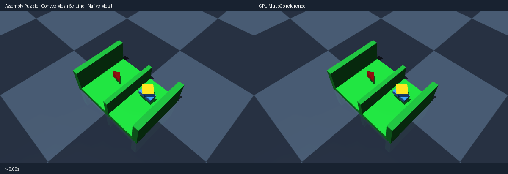

# Gravity assembly puzzle (convex mesh contact)

Use the [shared source setup](../INSTALL.md#development-source), with its Python
environment active, and run from the repository root. This demo requires current
source; the published 0.4.0 wheel alone does not contain these expanded paths.

Three project-authored procedural convex hulls drop into a divided tray under
gravity and Coulomb friction. The tetrahedron settles in the left lane; the brick
and octahedron stack in the right lane. Native Metal computes the compiled convex
mesh contact manifolds. Asset preprocessing is host work, and visualization uses
MuJoCo OpenGL. Arbitrary concave narrowphase is not advertised.

The unchanged 600-step comparison passes all original bounds: maximum position
error **1.679 mm** (20 mm bound), final error **0.334 mm**, maximum quaternion
component error **0.00377** (0.2 bound), and native/source compliant compression
**8.950 mm** (20 mm bound). Native contacts are active for 551 steps. Minimum
compiled-hull clearances are 74.53 mm for tetra/divider, 12.25 mm for octa/floor,
45 mm for octa/divider and 60 mm for octa/right wall. The explicit six-pair plan
is specific to this choreography: these omissions remain monitored, rather than
safe for arbitrary controls. Workspace admission uses current compiled capacities;
the old 24-slot/96-row description is obsolete.

Full literal 20-step checkpoint replays at steps 100 and 400 pass. The actual
Mac viewer advances native physics with CPU stepping forbidden. The 1x GIF and
viewer use the marble music machine lighting and a raised camera so the settled
pieces remain visible. Playback rate is not a throughput measurement.

Run the original CPU reference:

```bash
PYTHONPATH=metal:metal/examples python metal/examples/assembly_puzzle.py --mode cpu --headless --check --steps 600
```

Run the full Metal check and loaded checkpoint replays:

```bash
PYTORCH_ENABLE_MPS_FALLBACK=0 PYTHONPATH=metal:metal/examples python metal/examples/assembly_puzzle.py --headless --check --steps 600 --replay-check
```

Open the native Mac viewer (close the window to finish):

```bash
PYTORCH_ENABLE_MPS_FALLBACK=0 PYTHONPATH=metal:metal/examples python metal/examples/assembly_puzzle.py --viewer-seconds 30
```

Record the original full check, with native left and CPU reference right:

```bash
PYTORCH_ENABLE_MPS_FALLBACK=0 PYTHONPATH=metal:metal/examples python metal/examples/assembly_puzzle.py --headless --check --replay-check --steps 600 --record metal/examples/assets/assembly_puzzle.gif
```



The procedural assets are project originals under Apache-2.0. Qualification
covers the documented source-reference domains and integrated Euler contract;
other feature compositions remain subject to their own milestone gates.
