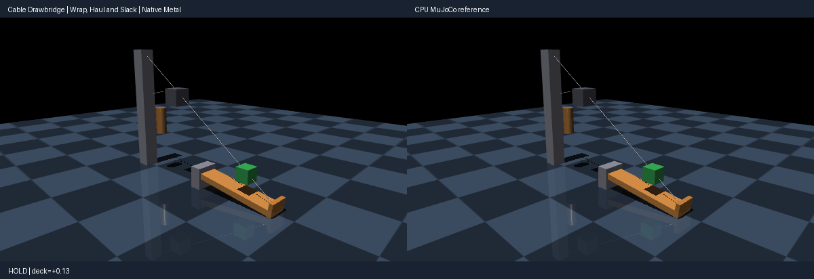

# Cable drawbridge (spatial tendon wrapping)

Use the [shared source setup](../INSTALL.md#development-source), with its Python
environment active, and run these commands from the repository root.
This integrated demo requires current main source; it is not supported by the
published 0.4.0 wheel alone.

A counterweight winch hauls a cable routed from the winch site around a
bollard cylinder wrap (with side-site selection), through a tower site, over a
pulley (divisor 3), to a hinged deck tip and a tower anchor. The tendon carries
spring/damper passive forces with a rest range, so the cable goes genuinely
slack when the winch releases and re-tensions on the next haul. A filter
actuator drives the winch open-loop: haul (tension, raise deck with its crate
payload), release (slack, lower deck), re-haul (re-tension, raise again).
A paired constant-slack run shows the deck never rises without hauling.
The simulation starts from the compiled `start` keyframe via
`sim.reset_to_keyframe`. Rendering uses MuJoCo OpenGL; playback speed is
presentation only, not a physics throughput claim.

Run a CPU reference smoke test:

```bash
PYTHONPATH=metal python metal/examples/cable_drawbridge.py --mode cpu --headless --steps 1400
```

Run the native Metal comparison check on an Apple Silicon Mac:

```bash
PYTORCH_ENABLE_MPS_FALLBACK=0 PYTHONPATH=metal:metal/examples python metal/examples/cable_drawbridge.py --headless --check --steps 1400
```

Record the side-by-side native Metal and CPU MuJoCo renders (left panel native,
right CPU):

```bash
PYTORCH_ENABLE_MPS_FALLBACK=0 PYTHONPATH=metal:metal/examples python metal/examples/cable_drawbridge.py --record metal/examples/assets/cable_drawbridge.gif --steps 1400
```

Launch the interactive viewer on a Mac (requires a display; headless
verification uses `--headless --check` plus the GIF above):

```bash
PYTORCH_ENABLE_MPS_FALLBACK=0 PYTHONPATH=metal:metal/examples python metal/examples/cable_drawbridge.py --steps 1400
```

Add `--viewer-seconds 20` to auto-close after 20 s of wall time. Without
it, the viewer runs the finite rollout and closes. Escape closes the window;
left drag orbits, right drag pans, middle drag or scrolling zooms. Main-thread
GLFW runs with ordinary Python on macOS. A three-second display smoke check
completed 45 actual native steps with CPU stepping forbidden. CPU forward
queries only mirror native state for OpenGL rendering.



The `--headless --check` run requires the complete 1,400-step schedule and
checks original native/CPU trajectory bounds, raised/lowered/re-raised deck,
genuine slack, re-tension and payload lift. A second full native run applies
constant release control; its deck never rises without hauling. Full checkpoint
replay is exact for 20 prescribed steps during release and re-haul.

Measured full-run results on MuJoCo 3.10.0, with the original XML, controls,
solver settings and numerical bounds unchanged:

- Native deck minimum: -0.675 rad; CPU minimum: -0.674 rad. CPU deck reaches
  +0.157 rad during release.
- Native cable: 1,022 taut and 378 slack steps; CPU: 1,025 taut and 375 slack.
- Crate peak height: 0.535 m in both runs, lifted from 0.28 m.
- Native final deck: -0.650 rad; constant-release deck: +0.131 rad.
- Maximum native/CPU linear-coordinate difference: 14.63 mm; scalar-joint
  difference: 0.00707 rad; normalized quaternion rotation difference: 0.10724 rad.
  Activation difference: 4.05e-7. Position, joint angle and rotation are distinct
  measurements; quaternion coefficients are not distances.

The default soft contacts briefly compress **18.31 mm native versus 18.57 mm CPU**
at impact. This model passes its original trajectory and behavior checks; it
does not establish a 1 mm penetration bound or perfectly rigid contact.
The crate slides off during release and the deck re-raises empty; this demo
qualifies payload lift, not a second lift or receiver delivery.
The new GIF contains 70 actual native/CPU frame pairs across 2.8 simulated
seconds, displayed at 25 fps (1x). It is not a throughput measurement.
Lighting and the dark checkerboard match the robotic marble music machine.
