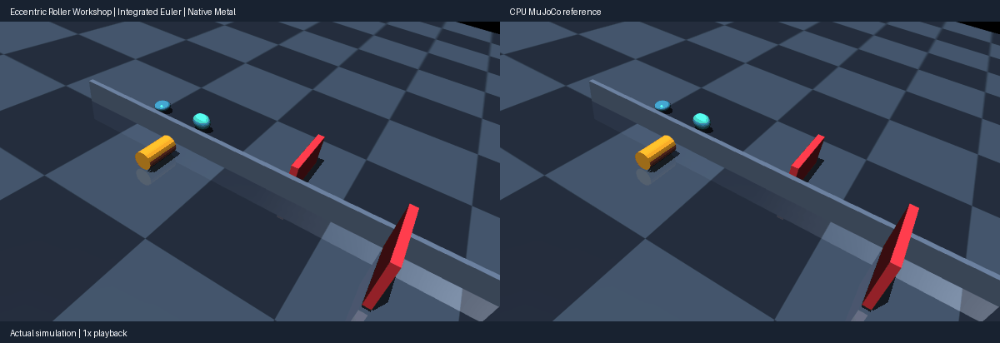

# Eccentric roller workshop

A cylindrical roller and two nonuniform ellipsoids move down a tilted table
into catch bins. The cylinder rolls with high sliding friction; the ellipsoids
slide and tumble with different friction settings. The pieces start in prescribed
lanes separated by a divider. This is a mechanical demonstration of cylinder and
ellipsoid contacts, rather than a general sorting controller.



## Run

Use the current source checkout and its active Python environment; see
[source installation](../INSTALL.md#development-source). Run from the repository
root on an Apple Silicon Mac with MPS available:

```sh
PYTHONPATH=metal python metal/examples/eccentric_roller.py --check --replay-check
PYTHONPATH=metal python metal/examples/eccentric_roller.py --record /tmp/roller.gif --check --replay-check
PYTHONPATH=metal python metal/examples/eccentric_roller.py --viewer-seconds 10
```

The bounded GLFW viewer runs on the main thread and advances native Metal
physics. MuJoCo OpenGL renders mirrored native poses; host forward/geometry
queries for display and independent measurements are separate from native
stepping. The published 0.4.0 wheel alone does not contain this integrated demo.

## Qualified behavior and limits

The original 900-step comparison passes its unchanged sorting, lane, 5 mm position
and 0.05 quaternion-component bounds. Maximum position difference is **0.708 mm**
and quaternion-component difference **0.00613**. The native run has **886 steps
with contact**, and complete 20-step checkpoint replays at steps 300 and 700 are
literal matches, including held inputs and solver state.

Independent native-pose measurements give at least **84.50 mm conservative
divider clearance**. Contacts with the table are compliant: maximum compression
is **6.82 mm native versus 6.76 mm CPU**. This does not qualify a 1 mm all-contact
penetration bound. The level-table control completes the same 900 steps with
all pieces remaining at their initial downhill positions, establishing the
slope's role in the motion.

The reviewed comparison has 45 frames over 1.8 seconds, matching 900 × 0.002 s
at **1× simulated time**. Execution takes longer; GIF playback is not a throughput
measurement. A three-second Mac viewer check rendered 22 actual native steps
with CPU stepping forbidden.

Rolling emerges from rigid-body dynamics and Coulomb sliding friction. Contacts
use `condim=3`, without a rolling-resistance torque. The prescribed lanes, shape
sizes, friction levels and filters are part of this bounded fixture. Separate
[analytic qualification](../QUALIFICATION.md) covers the pinned pair matrix,
both cones, material/option semantics, loaded impacts, degenerate features and
full replay. It does not establish every solver/integrator combination or all Macs.
