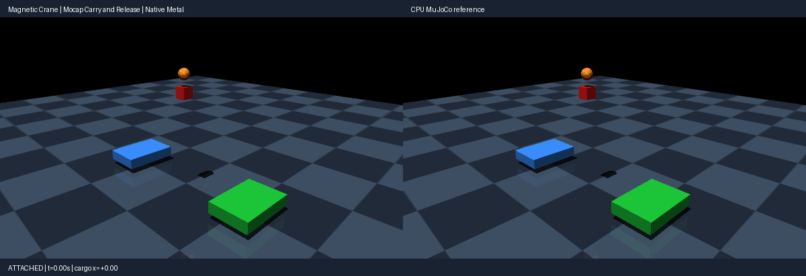

# Magnetic crane (mocap carry and release)

Use the [shared source setup](../INSTALL.md#development-source), with its Python
environment active, and run these commands from the repository root.
This integrated demo requires current main source; it is not supported by the
published 0.4.0 wheel alone.

A mocap hook carries a welded cargo box from staging to above the right bin,
then releases the weld through the public `sim.set_equality_active` API; the
cargo falls under gravity into the bin. Hook motion is prescribed
per-environment mocap input through the public `sim.set_mocap` API on a
deterministic schedule identical in CPU/native runs (hold 200 ms, translate to
the bin over 600 ms, hold, release at step 500 of 900, dt=0.002 s). A paired
always-attached run shows the physical effect of release. The simulation starts
from the compiled `start` keyframe via `sim.reset_to_keyframe`. Rendering uses
MuJoCo OpenGL; playback speed is presentation only, not a physics throughput
claim.

Run a CPU reference smoke test:

```bash
PYTHONPATH=metal python metal/examples/magnetic_crane.py --mode cpu --headless --steps 900
```

Run the native Metal comparison check on an Apple Silicon Mac:

```bash
PYTORCH_ENABLE_MPS_FALLBACK=0 PYTHONPATH=metal:metal/examples python metal/examples/magnetic_crane.py --headless --check --steps 900
```

Record the side-by-side native Metal and CPU MuJoCo renders (labels show
`ATTACHED`/`RELEASED` state and cargo position; left panel native, right CPU):

```bash
PYTORCH_ENABLE_MPS_FALLBACK=0 PYTHONPATH=metal:metal/examples python metal/examples/magnetic_crane.py --record metal/examples/assets/magnetic_crane.gif --steps 900
```

Launch the interactive viewer on a Mac (left-drag to orbit, right-drag to pan,
scroll to zoom, Escape to close). GLFW runs on Python’s main thread, avoiding
the passive viewer’s `mjpython` interpreter trampoline:

```bash
PYTORCH_ENABLE_MPS_FALLBACK=0 PYTHONPATH=metal:metal/examples python metal/examples/magnetic_crane.py --viewer
```

For an automatically closing viewer smoke test, add `--viewer-seconds 3`.



The `--headless --check` run asserts actual native behavior, not compilation:
weld force carries the cargo while attached and is removed after release, hook
body tracks the prescribed mocap target exactly, pre-release native/CPU pose
parity holds over the stable hold horizon, cargo contacts the bin, the released
cargo lands inside the right-bin footprint while the always-attached
native counterfactual stays suspended, with zero native bin contacts when
latched. A checkpoint taken during transport restores and reproduces the
complete final simulation checkpoint exactly, including retained precision
and solver seeds. Every native step must retain successful status.

Measured results from the full 900-step native check (MuJoCo 3.10.0):

- Stable-hold parity: qpos `3.54e-08`, qvel `3.86e-07`.
- Full-timeline maxima: qpos `1.13e-07`, qvel `1.86e-06`.
- Native weld force before/after release: `3.930` / `0.0`.
- Hook mocap tracking error: `0.0`.
- Native and CPU released bin contacts: `218` steps each; native and CPU
  always-attached counterfactual contacts: `0`.
- Released cargo `(x, z)`: `(0.70045, 0.19989)`; attached cargo:
  `(0.70000, 0.84963)`.
- Complete checkpoint replay: exact. The bounded Mac viewer smoke test
  advanced 66 native steps and exited normally.

Lighting and the dark checkerboard match the robotic marble music machine.
