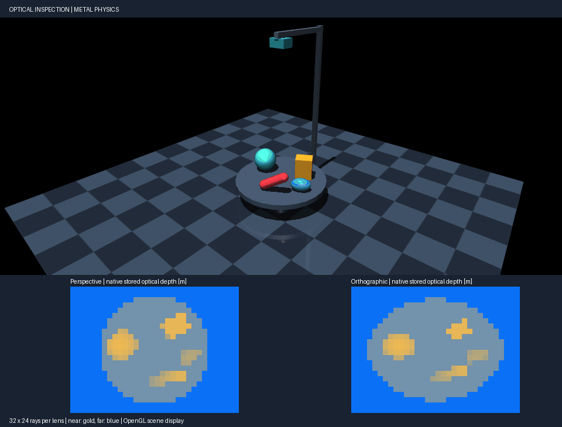

# Optical inspection carousel

A motor turns a tray of colorful parts beneath two depth cameras. The lower
panels show actual 32 × 24 RANGEFINDER samples: one perspective image and one
orthographic image. The shared color scale maps optical depth from 1.5 m (gold)
to 2.25 m (blue). Changing lens geometry changes the outline and sampling of
the same parts.

Physics, camera rays and intersections run on Metal in `--mode metal`. The
images come from stored step-stage sensor outputs, rather than a renderer
depth buffer. A separate CPU MuJoCo simulation receives the same initial
state and controls and checks every pixel. OpenGL renders the scene above the
depth panels; rendering and readback are outside native physics.

With the [source environment](../INSTALL.md#development-source) active, run:

```sh
PYTHONPATH=metal PYTORCH_ENABLE_MPS_FALLBACK=0 python metal/examples/optical_inspection.py \
  --mode metal --headless --check --steps 160
```

The installed CLI provides the same executable:

```sh
mujoco-metal demo optical_inspection --mode metal --headless --check --steps 160
```

Use `--mode cpu` for a CPU baseline. To save an actual native recording:

```sh
PYTHONPATH=metal PYTORCH_ENABLE_MPS_FALLBACK=0 python metal/examples/optical_inspection.py \
  --mode metal --headless --check --steps 160 \
  --record metal/examples/assets/optical_inspection.gif --record-seconds 3
```

The recording follows the initial check steps. `--check` verifies the entire
run, including recorded steps, and fails on native status errors, nonfinite
or missing hits, stationary images, or the stated comparison bounds. Save a
single frame with `--image inspection.png`. For the scene viewer, use
`mjpython` on macOS and `--viewer-seconds 10`; the viewer displays geometry,
while recordings show both geometry and depth panels.

The recorded native run completed 910 steps (3.64 simulated seconds). Its
maximum differences from CPU MuJoCo were 1.31 × 10⁻⁶ rad in angle,
8.52 × 10⁻⁷ rad/s in speed and 1.22 × 10⁻⁴ m in optical depth. These are
correctness checks for this fixture, not performance measurements or proof
of complete sensor or physics support.


