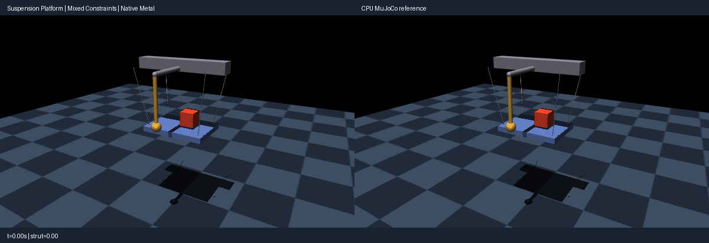

# Suspension platform (mixed rigid constraints)

Use the [shared source setup](../INSTALL.md#development-source), with its Python
environment active, and run these commands from the repository root.
This integrated demo requires the development source; the published 0.4.0 wheel
alone does not include it.

A mocap carrier tilts sinusoidally (±0.35 rad, 0.8 s period). Four spatial-tendon
cables suspend a platform carrying a loose crate. One cable limits travel, and
an equality couples a pair of cables. A ball-jointed strut hits its angular stop
alongside the platform; its offset mount keeps it clear of the cargo. Ball limits,
tendon limits, tendon equality, contact and prescribed carrier motion use one
coupled solver. A separate level-hold episode isolates carrier-induced motion
from settling under the load; it does not claim every constraint stays inactive.

The simulation starts at the compiled `start` keyframe. Each episode uses the
original 4,800 steps at 0.5 ms per step. The comparison GIF shows native Metal
physics on the left and CPU MuJoCo on the right for 2.4 seconds at 1× playback.
Rendering uses upstream OpenGL. Playback speed is not a physics throughput claim.

Open the interactive Mac viewer with ordinary Python:

```bash
PYTORCH_ENABLE_MPS_FALLBACK=0 PYTHONPATH=metal:metal/examples python metal/examples/suspension_platform.py
```

Drag to move the camera, scroll to zoom, or press Escape to close. For a bounded
viewer smoke check, append `--viewer-seconds 3`. The main-thread GLFW viewer
advances native Metal physics and mirrors its poses through CPU forward queries
for display; it does not use CPU stepping.

Run the complete native/CPU acceptance and level-hold comparison:

```bash
PYTORCH_ENABLE_MPS_FALLBACK=0 PYTHONPATH=metal:metal/examples python metal/examples/suspension_platform.py --headless --check --steps 4800
```

Record a new comparison GIF while checking the same original bounds:

```bash
PYTORCH_ENABLE_MPS_FALLBACK=0 PYTHONPATH=metal:metal/examples python metal/examples/suspension_platform.py --headless --check --record metal/examples/assets/suspension_platform.gif --steps 4800
```

Run the CPU reference alone:

```bash
PYTHONPATH=metal:metal/examples python metal/examples/suspension_platform.py --mode cpu --headless --steps 4800
```



Milestone 009 qualification on Apple Silicon with MuJoCo 3.10.0 completed both
original episodes. The source stayed frozen; all original acceptance bounds
passed. Independent full checkpoints replayed literally for 20 prescribed steps
at tilt steps 1,200 and 3,600. The refreshed GIF and a bounded native viewer
were visually reviewed. The viewer advanced 19 actual native steps in three
seconds with CPU stepping forbidden.

| Measurement | Native Metal | CPU reference / original bound |
|---|---:|---:|
| Maximum linear-coordinate difference | 0.215 mm | <5 mm |
| Maximum strut-axis difference | 0.04819 rad | <0.08 rad |
| Final strut-axis difference | 0.02556 rad | <0.05 rad |
| Maximum platform/cargo quaternion component difference | 0.001428 | <0.015 |
| Strut peak angle | 0.279865 rad | CPU 0.279919 rad; nominal stop 0.28 rad |
| Cable peak length | 0.659434 m | CPU 0.659978 m; nominal limit 0.66 m |
| Nominal strut-tip / cable overruns | 0 / 0 mm | Both ≤1 mm |
| Cargo contact steps | 4,701 / 4,800 | CPU 4,702 / 4,800 |
| Final platform lateral coordinate: tilt / level | 30.50 / 20.77 mm | Level <35 mm |
| Minimum strut/bob clearance from platform/cargo | 184.09 mm | No hardware overlap |

Native cable lengths come from independent Metal FK and tendon-query workspaces
at the accepted public native pose. A CPU kinematics/tendon query at that same
pose is a diagnostic only; it never advances physics. Their maximum length
comparison error is `2.98e-8 m`. Strict hardware geometry distances are measured
at accepted native poses; conservative uncertainty bounds are reported separately.

The configured soft stops are 0.2788 rad and 0.6578 m. Compliance can exceed
those configured values; the original 1 mm travel bounds apply to the stated
**nominal** 0.28 rad and 0.66 m limits. Cargo contact is also compliant: native
peak penetration is 5.17 mm in the tilt episode and 5.56 mm in level hold. These
are distinct from the strut/bob clearance and nominal stop-overrun checks.

The visible strut/bob is axisymmetric, so the demo separately checks the strut
axis, full relative angle and rigid platform/cargo orientation. Raw ball
quaternion components still differ by up to 0.09660. Axial twist is not globally
unconstrained: the ball stop measures the full relative rotation. Long-horizon
stop-driven motion is numerically sensitive, and this result does not establish
identical activation histories, every solver/integrator combination, broad Mac
hardware coverage or a performance gain. See [qualification](../QUALIFICATION.md).

Lighting and the checkerboard match the robotic marble music machine.
