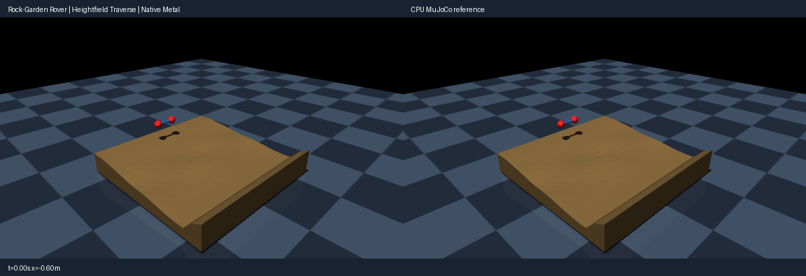

# Rock-garden axle cart (heightfield contact)

Use the [shared source setup](../INSTALL.md#development-source), with its Python
environment active, and run these commands from the repository root.
This integrated demo requires current main source; it is not supported by the
published 0.4.0 wheel alone.

A passive two-wheel axle cart (two sphere wheels fixed to a free body with a
visual axle capsule) launches with a small push and rolls across a
procedurally built heightfield: start pad, sine rock garden, catch flat and
stop berm. Gravity plus Coulomb friction (elliptic cone) drive it across
multiple terrain cells; wheel/terrain contacts exercise native per-prism
heightfield narrow phase (one witness per overlapped terrain prism, same
traversal order as the pinned engine). Rest equilibria with friction are
non-unique, so the check gates traverse distance, rolling, clearance,
impact-transient and settle envelopes plus early parity, not exact rest poses.
Rendering uses MuJoCo OpenGL; playback speed is presentation only, not a
physics throughput claim.

Run a CPU reference smoke test:

```bash
PYTHONPATH=metal python metal/examples/terrain_rover.py --mode cpu --headless --check --steps 800
```

Run the native Metal comparison check on an Apple Silicon Mac:

```bash
PYTORCH_ENABLE_MPS_FALLBACK=0 PYTHONPATH=metal:metal/examples python metal/examples/terrain_rover.py --headless --check --steps 800
```

Record the side-by-side native Metal and CPU MuJoCo renders (left panel native,
right CPU):

```bash
PYTORCH_ENABLE_MPS_FALLBACK=0 PYTHONPATH=metal:metal/examples python metal/examples/terrain_rover.py --record metal/examples/assets/terrain_rover.gif --steps 800
```



The original 800-step check passes with its unchanged XML, initial velocity
0.3 m/s, timestep 0.002 s, pair plan and controls. Travel is 1.244891 m,
roll is 2.363408 rad and minimum axle height is 0.044579 m. Maximum position
error is 0.0004464 mm and maximum quaternion error is 0.000008583. Maximum
compliant compression is 10.670 mm; this is soft contact, not a rigid clearance
or arbitrary tunneling guarantee.

The original bounds remain travel >0.5 m, roll >1 rad, axle height >-0.05 m,
preflight position error <0.5 mm, full/final position error <20 mm, final
quaternion error <0.15, full quaternion error <0.2 and compression <20 mm.
Native wheel and actual terrain-prism witnesses pass independent 6 µm surface
checks at 6,884 contacts across 98 prisms. Complete loaded 20-step changing-force
restore/replays at steps 200 and 600 reproduce every checkpoint and physical
field, including the actual retained lambda low words.

The collision-free visual axle capsule has `contype=0`. The two wheel pairs
reserve the full fifty-contact source bound each (`max_slots=100`,
`max_rows=408`); manifolds are not truncated to eight contacts. Milestone 012
also qualifies compiled convex mesh–heightfield contact separately.
Heightfield–heightfield remains rejected; plane–heightfield produces no contact.
HField–SDF and flex terrain retain milestones 013 and 018.

The fresh complete GIF has 40 frames over 1.6 seconds at 1× playback, with both
wheels and the axle visible throughout. The actual bounded Mac viewer passes
120 native steps and rendered frames with CPU stepping forbidden. Rendering
uses MuJoCo OpenGL; this is correctness evidence, not a throughput benchmark.
Lighting and the dark checkerboard match the robotic marble music machine.
